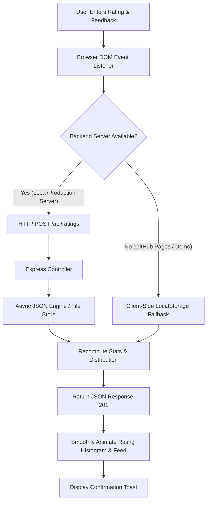
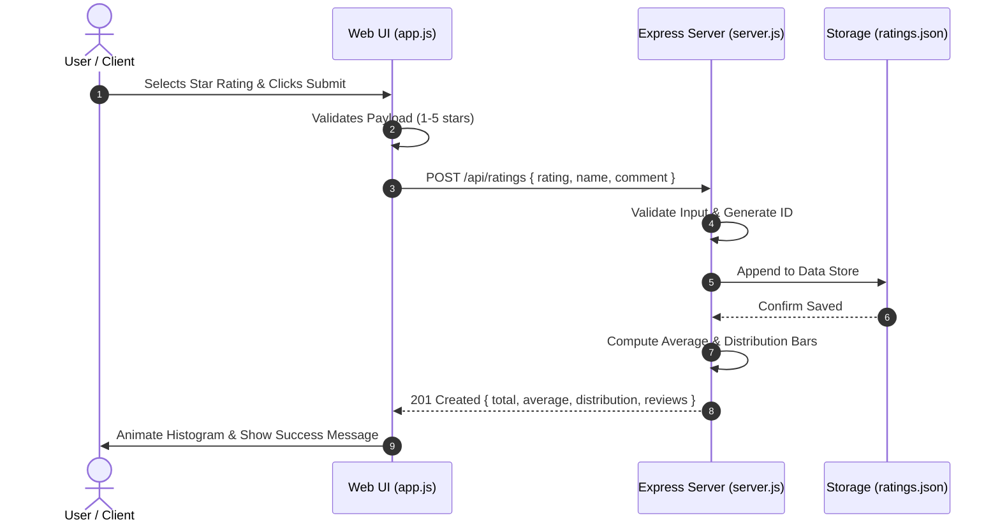

<div align="center">

# ⭐ Star Rating Widget & Feedback Hub

**A modern, responsive, and accessible 5-star rating widget featuring real-time rating distributions and review submissions.**

[](https://opensource.org/licenses/MIT)
[](https://nodejs.org/)
[](https://expressjs.com/)
[](https://gugulothuyashwanth-dot.github.io/star-rating-widget-nodejs/)
[](CONTRIBUTING.md)

<br />

[🚀 **Explore the Live Demo**](https://gugulothuyashwanth-dot.github.io/star-rating-widget-nodejs/) • [🐛 Report Bug](https://github.com/gugulothuyashwanth-dot/star-rating-widget-nodejs/issues) • [💡 Request Feature](https://github.com/gugulothuyashwanth-dot/star-rating-widget-nodejs/issues)

</div>

---

## 📖 Table of Contents
- [✨ Features](#-features)
- [🖥️ UI / UX Highlights](#️-ui--ux-highlights)
- [🔄 Architecture & Workflow](#-architecture--workflow)
- [🛠️ Tech Stack](#️-tech-stack)
- [🚀 Quickstart & Installation](#-quickstart--installation)
- [📡 REST API Reference](#-rest-api-reference)
- [📁 Project Structure](#-project-structure)
- [🌐 Live Deployment](#-live-deployment)
- [🤝 Contributing](#-contributing)
- [📄 License](#-license)

---

## ✨ Features

- **Interactive Star Rating**: Smooth micro-interactions, scale bounce effects, and instant sentiment feedback (e.g. *🤩 Excellent*, *😊 Very Good*).
- **Live Rating Breakdown Histogram**: Amazon / Play Store style progress bars displaying distributions across 1★ through 5★ ratings in real-time.
- **Review & Feedback Submissions**: Allows reviewers to attach optional names and review comments with their rating.
- **Dual-Mode Persistence Architecture**:
  - **Server-Mode**: Automatically persists data asynchronously into `ratings.json` through an Express REST API.
  - **Static Demo Mode**: Seamlessly falls back to client-side `localStorage` when hosted on GitHub Pages or static hosts where no Node runtime is present.
- **Accessible (WAI-ARIA Compliant)**: Full keyboard navigation (Arrow Left / Right / Up / Down, Enter, Space) with semantic ARIA roles.
- **Glassmorphic Aesthetic**: Modern gradient background with floating glowing ambient orbs and sleek cards.

---

## 🖥️ UI / UX Highlights

| Feature | Description |
| :--- | :--- |
| **Micro-Interactions** | Scale pop animations on hover, focus, and selection with gold glow drop-shadows. |
| **Distribution Bars** | Visual percentage bars that smoothly animate to represent sentiment breakdown. |
| **Sentiment Tags** | Dynamic emoji badges giving emotional context to selected numerical ratings. |
| **Community Feed** | Feed of recent feedback entries showing author, star rating, and comments. |

---

## 🔄 Architecture & Workflow

### 1. Data Flow & Execution Pipeline



### 2. Request / Response Lifecycle



---

## 🛠️ Tech Stack

- **Backend**: [Node.js](https://nodejs.org/) (Async File I/O Engine), [Express.js](https://expressjs.com/) (RESTful API Router)
- **Frontend**: Vanilla JavaScript (ES6+), HTML5 (Semantic & Accessible), CSS3 (Modern Glassmorphism & Custom Properties)
- **Deployment**: [GitHub Actions](https://github.com/features/actions) & [GitHub Pages](https://pages.github.com/) for automated continuous static hosting
- **Typography**: [Google Fonts (Plus Jakarta Sans)](https://fonts.google.com/specimen/Plus+Jakarta+Sans)

---

## 🚀 Quickstart & Installation

### Prerequisites
- [Node.js](https://nodejs.org/) (v16.0.0 or higher recommended)
- [npm](https://www.npmjs.com/) (v8.0.0 or higher)

### Steps

1. **Clone the repository:**
   ```bash
   git clone https://github.com/gugulothuyashwanth-dot/star-rating-widget-nodejs.git
   cd star-rating-widget-nodejs
   ```

2. **Install dependencies:**
   ```bash
   npm install
   ```

3. **Start the local server:**
   ```bash
   # Production mode
   npm start

   # Development mode with live reload
   npm run dev
   ```

4. **Access the application:**
   Open your browser and navigate to:
   ```text
   http://localhost:3000
   ```

---

## 📡 REST API Reference

### 1. Get Aggregated Ratings & Stats
Retrieves the overall average score, total rating count, distribution histogram, and recent review items.

- **Endpoint**: `/api/ratings`
- **Method**: `GET`
- **Sample Response**:
  ```json
  {
    "success": true,
    "total": 3,
    "average": 4.7,
    "distribution": {
      "1": 0,
      "2": 0,
      "3": 0,
      "4": 1,
      "5": 2
    },
    "reviews": [
      {
        "id": "1731074400000",
        "rating": 5,
        "name": "Sophia Martinez",
        "comment": "Clean layout, love the distribution breakdown bar.",
        "createdAt": "2026-11-08T14:00:00.000Z"
      }
    ]
  }
  ```

---

### 2. Submit a New Rating
Appends a new rating entry and recalculates real-time statistics.

- **Endpoint**: `/api/ratings`
- **Method**: `POST`
- **Headers**: `Content-Type: application/json`
- **Request Body**:
  ```json
  {
    "rating": 5,
    "name": "Yashwanth",
    "comment": "Awesome widget! Very clean interface and smooth animations."
  }
  ```
- **Response**: `201 Created`
  ```json
  {
    "success": true,
    "message": "Thank you for your valuable feedback!",
    "total": 4,
    "average": 4.8,
    "distribution": { "1": 0, "2": 0, "3": 0, "4": 1, "5": 3 }
  }
  ```

---

## 📁 Project Structure

```text
star-rating-widget-nodejs/
├── docs/                   # Production Static Build for GitHub Pages
│   ├── index.html          # Semantic HTML5 layout with ARIA attributes
│   ├── style.css           # Glassmorphic styles and keyframe animations
│   └── app.js              # Interactive star logic, dual-mode API & stats
├── public/                 # Static Assets served by Express server
│   ├── index.html          # Frontend template
│   ├── style.css           # Styling rules
│   └── app.js              # Client script
├── .gitignore              # Ignored files (node_modules, logs, ratings.json)
├── index.html              # Root redirect
├── LICENSE                 # MIT Open Source License
├── package.json            # Node.js project metadata and scripts
├── ratings.json            # Persistent rating storage (auto-generated)
├── README.md               # Project documentation and architectural guide
└── server.js               # Express server and async REST endpoints
```

---

## 🌐 Live Deployment

### Instant GitHub Pages Hosting
This repository is configured for immediate GitHub Pages deployment from the `/docs` folder:

1. Go to your repository on GitHub: `Settings > Pages`.
2. Under **Build and deployment**:
   - **Source**: `Deploy from a branch`
   - **Branch**: `main`
   - **Folder**: `/docs`
3. Click **Save**. In ~1-2 minutes, your live site will be accessible worldwide at:
   ```text
   https://gugulothuyashwanth-dot.github.io/star-rating-widget-nodejs/
   ```
*(In static hosting mode, the widget automatically activates **Demo Mode** with persistent `localStorage` support so anyone can test the rating and review system interactively without a live server!)*

### Free Node.js Cloud Hosting (Render / Railway / Glitch)
For continuous backend persistence with Node.js:
1. Connect your GitHub repository to [Render](https://render.com/) or [Railway](https://railway.app/).
2. Set Build Command: `npm install`
3. Set Start Command: `npm start`
4. The service will assign a public HTTPS domain with full server-side file persistence!

---

## 🤝 Contributing

Contributions, feedback, and feature suggestions are welcome!

1. Fork the Project
2. Create your Feature Branch (`git checkout -b feature/AmazingFeature`)
3. Commit your Changes (`git commit -m 'Add some AmazingFeature'`)
4. Push to the Branch (`git push origin feature/AmazingFeature`)
5. Open a Pull Request

---

## 📄 License

Distributed under the **MIT License**. See [`LICENSE`](LICENSE) for more information.

<div align="center">
  <sub>Built with ❤️ by <a href="https://github.com/gugulothuyashwanth-dot">Gugulothu Yashwanth</a></sub>
</div>
